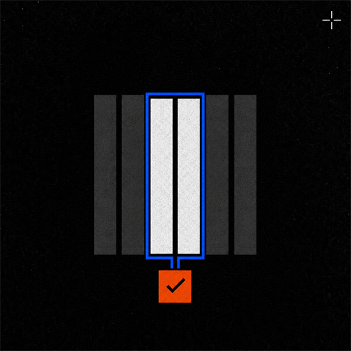
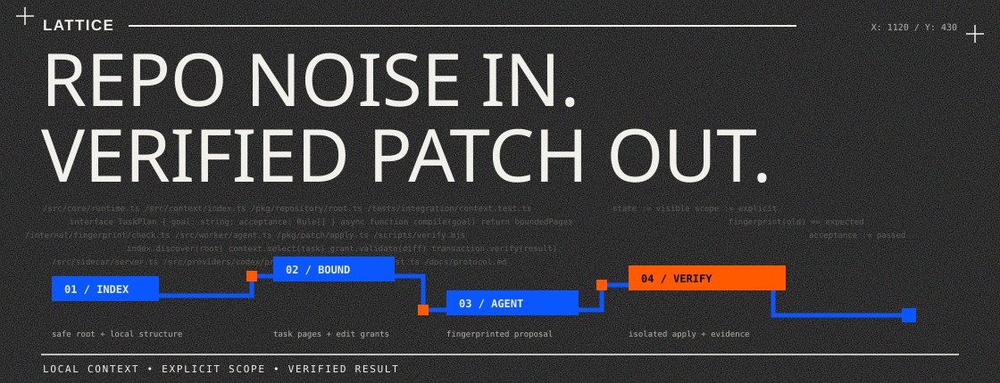

<p align="center">
  
</p>

<h1 align="center">Lattice: Capability-Scoped Context and<br>Fingerprint-Verified Patching for Coding Agents</h1>

<p align="center">
  <strong>Moulwyse</strong><br>
  <a href="https://github.com/moulwyse">github.com/moulwyse</a> · <a href="mailto:ptech1500@gmail.com">ptech1500@gmail.com</a>
</p>

<p align="center"><em>Technical report · Lattice v2.1.0 · November 2026</em></p>

<p align="center">
  <a href="https://github.com/moulwyse/lattice/actions/workflows/ci.yml"></a>
  <a href="https://github.com/moulwyse/lattice/actions/workflows/quality.yml"></a>
  <a href="LICENSE"></a>
  <a href="https://github.com/moulwyse/lattice/releases"></a>
</p>

---

<table><tr><td>

**Abstract.** An autonomous coding agent typically holds three powers at once:
it chooses what to read, it writes to the repository, and it judges whether its
own change is correct. We argue that only the first of these needs a language
model, and only partly. *Lattice* is an execution layer that takes the other
two away from the model and returns them to deterministic code. The model sees
a budgeted set of *context pages* chosen by a local relevance index; it may
change the repository only through opaque *edit handles*, each a capability
bound to a task, session, repository identity, base commit, path and content
fingerprint; and its proposal is accepted only after a transaction replays it
in an isolated Git worktree and an allowlisted test command exits with zero.
Every step is a transition in an explicit 16-state machine, so failures,
context requests and revisions are recorded rather than absorbed. On a public
five-file fixture, five paired runs across three Claude and GPT model
generations reduced fresh input-plus-output tokens by 57.8–87.3% and
end-to-end time by 51.7–77.9% relative to the same agent run without Lattice,
with all acceptance tests passing in both arms where measured. These are
single-fixture smoke tests, and we state precisely what they do not show.

</td></tr></table>

**Keywords:** coding agents · capability security · context selection ·
program repair · transactional verification · LLM evaluation

---

## 1. Introduction

A coding agent built on a frontier model spends much of its budget on work
that has a correct answer computable without the model: locating the file
that defines a symbol, re-reading it after every edit, checking whether a
patch still applies, running the test suite and reading the result. In an
unconstrained agent loop each of these is a model turn, and each turn re-sends
a growing transcript.

The same loop also concentrates authority. The process that proposes a change
is the process that writes it to disk and the process that decides it is done.
When the model is wrong, the error reaches the working tree before any check
has run.

Lattice separates these roles:

| Role | Plain agent | Lattice |
| --- | --- | --- |
| Choose context | model, by exploration | local index proposes; model may request more within a budget |
| Write files | model, via native tools | runtime, via edit-grant lowering |
| Decide correctness | model | allowlisted tests in an isolated worktree |

**Contributions.**

1. A *capability model for edits* in which a model never names a file it may
   modify; it cites a handle whose scope, permitted operations and expected
   content are fixed by the runtime (§3.3).
2. A *budgeted context kernel* that serves exact line-ranged pages with
   provenance and fingerprints, and treats additional reads as explicit,
   bounded *context faults* (§3.2).
3. A *transactional verifier* that reproduces the user's uncommitted state and
   dependencies in a throwaway worktree, re-checks fingerprints before
   application, and returns concrete failures to the model for at most two
   revisions (§3.4).
4. An open implementation with adapters for Codex and Claude Code, a
   credential-free functional benchmark, a 240-case safety suite, published
   paired measurements and a pre-registration protocol for stronger
   evaluation (§4–§5).

## 2. Threat and trust model

Lattice trusts the operator to choose a repository and a provider. It treats
**all model output as untrusted structured input**: a response is a claim to
be parsed, validated against a schema, bound to capabilities and tested, never
an instruction to execute. It relies on Git and the operating system for
filesystem and process isolation, and on the repository's own tests for
semantic correctness.

Lattice is *not* a sandbox. When it is attached to an agent whose native tools
remain enabled, those tools can still read outside the Lattice context path.
The guarantees below concern what reaches the user's working tree through
Lattice, not what a surrounding agent can observe.

## 3. Design

<p align="center">
  
</p>
<p align="center"><sub><strong>Figure 1.</strong> A Lattice run: compile the goal, index the repository, grant context and edit handles, obtain a proposal, lower it to an internal patch, replay it in an isolated worktree, verify, apply.</sub></p>

### 3.1 Task compilation

A free-form goal is compiled into a versioned task IR containing:

- **acceptance criteria**, split syntactically from the goal (sentences,
  clauses, list items) so that no task-specific vocabulary is built into the
  compiler;
- **invariants**, extracted from "do not …" and "preserve …" phrases;
- a **risk class** (`low`, `medium`, `high`); goals touching authentication,
  security, permissions, migrations, concurrency, cryptography or payments are
  high risk, and risk is never silently downgraded;
- a **budget**: by default 12,000 context tokens, 20 pages, 3 context faults
  and 4 model turns;
- an **allowlist** of verification commands: common `npm`/`npx` test, lint and
  build commands, extended with the repository's own `test*`, `check`,
  `lint`, `typecheck` and `build` scripts. Script names come from the index of
  `package.json`, never from the model; watch, dev-server and UI modes are
  excluded because they do not terminate.

### 3.2 Context kernel

The indexer records, for each file, its path, fingerprint, imports, exports,
symbols and whether it is a test or configuration file. Discovery refuses
dangerously broad roots such as a filesystem root or home directory, honours
ignore rules and never follows a symlink or junction out of the repository.

Files are ranked for a task by a transparent lexical score: each distinct goal
term contributes 8 if it occurs in the path, 5 if it occurs in an exported
symbol and 2 if it occurs in a reference, with a small prior for tests. The
initial context combines the most relevant tests with the sources they import,
resolving TypeScript ESM specifiers back to their source files.

A **context page** is an exact line range with its content, reason,
provenance, token estimate and the fingerprint of the file it came from. Files
up to 12,000 characters (32,000 for high-risk tasks) are served whole;
larger files are served as a slice of about 6,000 characters centred on the
lines that best match the task. Before a page is served, the file is re-hashed;
if it changed since indexing, the page is refused.

The model also receives a **repository map** of ungranted files with up to
eight symbols each. The map is ranked and capped at 12,000 characters, so the
prompt does not grow with repository size. To read more, the model returns a
`context_request` naming a path hint and optional symbol. These are hints, not
authority: the kernel decides whether a page is granted within the remaining
budget.

### 3.3 Edit grants

Every editable page yields an **edit grant**, identified to the model only by
an opaque handle (`E1`, `E2`, …). A grant binds:

```
handle → (task, session, repository id, base commit, context epoch,
          path, content fingerprint, line range, permitted operations)
```

The grant registry is stored with a SHA-256 digest of its canonical form, so a
modified registry is detectable. Permissions follow from how the file was
granted:

| Operation | Addressed by | Permitted when |
| --- | --- | --- |
| `replace_text` | handle | any editable grant; `oldContent` must occur exactly once inside the granted range |
| `replace_file`, `delete_file` | handle | the whole file was granted |
| `create_file` | path | the path is new, repository-relative, not Git-ignored and has no hidden segment |

`create_file` is the only operation that carries a path, and it can never
overwrite an existing file. Hidden paths (`.github/`, `.husky/`, `.vscode/`,
`.envrc`, `.git/`, `.lattice/`, …) are refused because configuration there can
execute code. Test pages are granted read-only: a model cannot make a failing
test pass by editing it, although it may add new tests.

**Fingerprints.** For a tracked file the fingerprint is the Git object id that
Git's own clean filters assign to the working bytes; Lattice probes the three
`core.autocrlf` policies so that a checkout produced on another platform still
matches its index entry. Untracked files and symlinks fall back to a raw
SHA-256 and byte length. Only pages with a Git fingerprint receive write
permissions.

**Lowering.** A provider response is validated against a versioned schema and
*lowered* into an internal patch IR that carries exact paths and expected
fingerprints. The provider protocol and the internal IR are deliberately
distinct types, so convenience features in an adapter cannot widen mutation
authority. Unknown schema versions fail closed.

### 3.4 Transactional verification

The lowered patch is applied in a fresh Git worktree beneath `.lattice/`. The
worktree first reproduces the user's uncommitted changes and links installed
`node_modules`, so verification observes the same sources and dependencies
the user would. Each change is checked against its expected fingerprint inside
the worktree. Verification commands from the allowlist then run with bounded
process control; a command that exceeds its deadline is a failure (exit code
124). A task **passes** iff at least one allowlisted command ran and every one
exited with zero.

On rejection or failure, the model receives a `PATCH_REVISION` turn carrying
the concrete reason: the lowering error, or the failing command with the tail
of its output. At most two revisions are allowed, within the turn budget.

A passed patch reaches the user's working tree only through `git apply`, and
only after every source fingerprint has been re-checked against the
workspace; `--no-apply` stops after verification and prints the diff.
Worktrees left behind by a crashed process are identified by owner records and
removed.

### 3.5 Explicit runtime state

A run is a path through a fixed state machine:

```
CREATED → COMPILED → INDEXED → CONTEXT_GRANTED → WORKER_RUNNING
  → RESPONSE_NORMALIZED → RESPONSE_VALIDATED
      ├─ CONTEXT_FAULT  → CONTEXT_GRANTED
      ├─ PATCH_REVISION → WORKER_RUNNING
      └─ PATCH_LOWERED  → TRANSACTION_RUNNING → VERIFYING
                                                 ├─ PASSED
                                                 └─ PATCH_REVISION
  WORKER_RUNNING → PROTOCOL_REPAIR → WORKER_RUNNING
  (any non-terminal state) → FAILED | CANCELLED
```

Illegal transitions raise errors. Every transition is time-stamped with its
reason, so a protocol repair, a context fault or a failed verification is
visible in telemetry instead of being folded into a successful answer.

### 3.6 Optional mechanisms

- **Verified-patch cache** (experimental, opt-in). A verified internal patch is
  stored under a key derived from repository identity, base commit, the
  compiled task and the fingerprints of every indexed file. Any change to
  these produces a different key.
- **Adaptive model policy** (experimental, opt-in). Model and reasoning effort
  may be chosen from task risk. Explicit CLI flags, configuration and an
  observed agent session all take precedence; when a session is present,
  inheritance is preferred over substitution.
- **Live-evaluation budget guard.** Paid benchmark drivers read the
  provider's rate-limit windows before starting and refuse to run if an
  evaluation would exceed a 10% share of a window. The guard fails closed.

## 4. Implementation

Lattice is a TypeScript command-line tool (`lattice`) of roughly 14,500 lines
for Node.js `^20.19.0` or `>=22.12.0`, released under Apache-2.0. State lives
in a repository-local `.lattice/` directory that Lattice adds to the clone's
`.git/info/exclude`. Metadata writes go to a fresh temporary file that is
renamed into place, so a planted symlink or hard link at the destination
cannot redirect them, and the metadata directory itself may not be a link
that leaves the repository.

**Workers.** The runtime is provider-agnostic. A worker only proposes; it
never writes.

| Worker | Status | Isolation |
| --- | --- | --- |
| Mock (deterministic, fixture-specific) | available | no model call |
| Manual handoff | available | operator carries request and response |
| Claude Agent SDK | available | native tools disabled, empty MCP configuration |
| Codex SDK | beta | empty scratch directory, no user MCP servers, hooks or plugins |

**Agent integrations.** Both are opt-in and reversible, and removal touches
only state Lattice recognises as its own.

- *Claude Code*: per-repository, launched as `lattice claude`;
  `lattice claude --raw` starts the same bundled Claude Code with Lattice
  bypassed. Contract-tested with Claude Agent SDK `0.3.281` and Claude Code
  `2.1.281`.
- *Codex* (experimental transparent mode): ownership-checked launcher shims,
  Codex hooks, an MCP server registration, a repository-scoped sidecar and
  session-setting synchronisation. It is an adapter over the same context and
  grant primitives, not a second authority path.

**Quality.** The repository contains 32 test files run with Vitest, linting,
format checks, a packaging check and a public-export scanner that reports,
but never deletes, suspicious artifacts. CI builds and tests on Ubuntu,
Windows and macOS with Node.js 20 and 22.

## 5. Evaluation

### 5.1 Fixture and procedure

All live measurements use `fixtures/reset-token`, a public five-file Node.js
project whose baseline fails two of four tests. The task asks the agent to
consume a valid password-reset token once, reject reuse and expired tokens,
record an audit event and leave login behaviour unchanged.

Each measurement is one **pair**: a plain arm (the agent as shipped, in a fresh
temporary repository) followed by a Lattice arm (native tools off, empty MCP
configuration, patch cache off, isolated worktree) on the same baseline
commit. Candidate sources from each arm are then tested in an independent
pristine directory with the original tests. Token counts are provider-reported;
cached input is reported separately and excluded from "fresh".

### 5.2 Results

<p align="center"><sub><strong>Table 1.</strong> Paired results on the reset-token fixture. Reduction = 1 − Lattice/plain. Each row is a single pair.</sub></p>

| Model / effort | Lattice | Operator | Fresh in+out, plain → Lattice | Reduction | End-to-end time | Reduction |
| --- | --- | --- | ---: | ---: | ---: | ---: |
| Claude Opus 5.5 / high | v2.0.1 | owner | 37,279 → 4,747 | **87.3%** | 35.0 s → 10.3 s | **70.4%** |
| GPT-5.6 Luna | v1.0.0 | owner | 73,394 → 10,541 | 85.6% | 100.8 s → 22.3 s | 77.9% |
| Claude Opus 5 | v1.0.0 | community | 21,020 → 3,901 | 81.4% | 46.6 s → 13.6 s | 70.8% |
| GPT-6 Astra / medium | v1.0.0 | owner | 16,872 → 4,005 | 76.3% | 70.2 s → 27.0 s | 61.6%* |
| GPT-5.6 Sol | v1.0.0 | owner | 24,985 → 10,555 | 57.8% | 63.4 s → 30.7 s | 51.7% |

<sub>* Arm time, excluding setup, checkpoint and cleanup.</sub>

For the two Claude pairs the provider also reported cost:
$0.362 → $0.048 (−86.8%) for Opus 5.5 and $0.280 → $0.048 (−82.8%) for Opus 5.

### 5.3 Where the savings come from

The Opus 5.5 pair is the cleanest comparison: both arms received identical task
text, the Lattice arm added no fixture-specific criteria, both passed 4/4
pristine acceptance tests, and both edited the same two files with
functionally equivalent patches. The plain agent used **eight model turns** to
explore, edit and test; Lattice used **one**, with zero context faults and
zero protocol repairs. On a repository this small, the reduction comes mostly
from removing turns, not from sending less of the repository. The plain arm
also consumed 194,670 cached input tokens, which Lattice did not need at all.

### 5.4 What these results do not show

- **One fixture.** Five files, one task, maintainer-authored. No confidence
  interval can be computed from one pair per model.
- **Not like-for-like across versions.** The four v1.0.0 pairs gave the Lattice
  arm extra, fixture-specific acceptance criteria that the plain arm did
  not receive. They should be re-measured before being cited.
- **Not independent.** Four of five pairs were run by the author.
- **Not a ranking.** Rows use different models, efforts and dates and are not
  comparable to each other.
- **Not a quality claim.** A smaller context is not automatically a correct
  context; verification is only as strong as the repository's tests.

### 5.5 Deterministic evidence

Two results require no model and are reproducible by anyone:

- `lattice benchmark --worker mock` runs the full pipeline with a
  deterministic worker and ends with `Status: passed`. It is a functional
  check, not a measure of savings.
- `npm run evidence:frontier` runs 240 contract cases in five groups of 48:
  task risk is never silently downgraded; the provider protocol fails closed;
  paths stay confined to the repository; patch lowering is exact; and the
  live-evaluation budget guard fails closed. The published result is 240/240
  ([JSON](docs/evidence/economy-frontier.json)).

### 5.6 Protocol for stronger claims

[docs/evaluation.md](docs/evaluation.md) specifies a pre-registered design:
evaluator-selected tasks (pilot ≥ 20, technical ≈ 100), frozen Lattice
configuration before tasks are revealed, byte-identical starting snapshots,
randomised run order, provider-reported usage summed over every model call,
a non-inferiority margin on task success, a 2×2 paired outcome table, and
paired medians with bootstrap intervals for tokens and time. Spend-gated
drivers are in [benchmarks/](benchmarks/README.md).

## 6. Limitations

Lattice is an early release, not a hosted service and not a security boundary.
Relevance ranking is lexical and can miss context that a model would find by
exploration; the context-fault mechanism mitigates this only within budget.
Verification is limited to the allowlist and to what the repository's tests
cover. The transparent Codex integration modifies user-level configuration
when enabled and remains experimental; live Omarchy sessions and automatic
macOS integration are unverified. `.lattice/` may contain source excerpts,
diffs and diagnostics and should be treated as sensitive. Context sent to a
provider is governed by that provider's terms. The full list is in
[docs/limitations.md](docs/limitations.md) and [SECURITY.md](SECURITY.md).

## 7. Conclusion

Most of what a coding agent does between reading a task and delivering a
patch is deterministic. Lattice moves that work into code that is local,
budgeted and auditable, and narrows the model's role to proposing changes
through capabilities it cannot widen. Early paired measurements suggest that
the resulting reduction in model turns translates into large savings in
tokens and time without loss of acceptance on a small task. Whether that holds
on large repositories and hard tasks is the question the published protocol
is designed to answer.

---

## References

1. OpenAI. *Codex.* <https://openai.com/codex>
2. Anthropic. *Claude Code.* <https://claude.com/claude-code>
3. Anthropic. *Claude Agent SDK.* <https://docs.claude.com/en/api/agent-sdk/overview>
4. *Model Context Protocol.* <https://modelcontextprotocol.io>
5. Git project. *git-worktree* and *git-hash-object.* <https://git-scm.com/docs>
6. J. B. Dennis and E. C. Van Horn. Programming semantics for multiprogrammed computations. *Communications of the ACM*, 9(3):143–155, 1966.

## Citation

```bibtex
@software{moulwyse2026lattice,
  author  = {Moulwyse},
  title   = {Lattice: Capability-Scoped Context and Fingerprint-Verified Patching for Coding Agents},
  version = {2.1.0},
  year    = {2026},
  url     = {https://github.com/moulwyse/lattice},
  license = {Apache-2.0}
}
```

Machine-readable metadata: [CITATION.cff](CITATION.cff).

---

## Appendix A. Getting started

Requires [Git](https://git-scm.com/downloads) and Node.js `20.19+` or
`22.12+`. No API key is needed to install or self-test.

```sh
npm install --global https://github.com/moulwyse/lattice/releases/download/v2.1.0/lattice-v2-2.1.0.tgz
lattice doctor --workspace .
lattice benchmark --worker mock        # expect: Status: passed
```

Installer scripts: `scripts/install.ps1` (Windows) and `scripts/install.sh`
(Linux, macOS). From source: `git clone`, `npm ci`, `npm run build`,
`npm link`. Installing directly from a Git URL fails on npm 11+ because dev
dependencies are not installed for global Git packages.

```sh
lattice integration claude enable --workspace .   # Claude Code, this repository only
lattice claude

lattice integration codex doctor --workspace .    # Codex (experimental transparent mode)
lattice integration codex enable
```

Remove with `lattice integration … disable` and
`npm uninstall --global lattice-v2`. Details:
[installation](docs/installation.md), [Claude Code](docs/claude-code.md),
[Codex quick start](docs/quick-start.md), [configuration](docs/configuration.md),
[troubleshooting](docs/troubleshooting.md).

## Appendix B. Command summary

```text
lattice run "<task>" --worker mock|manual|codex|claude [--no-apply]
lattice continue <task-id>
lattice handoff validate <task-id>
lattice session new|show|reset
lattice doctor | benchmark --worker mock
lattice integration codex status|doctor|enable|disable
lattice integration claude status|enable|disable
lattice claude [--raw]
lattice sidecar status|stop
```

## Appendix C. Worker protocol

A worker returns one of two versioned messages.

```json
{ "schemaVersion": 1, "kind": "context_request",
  "requests": [{ "reason": "need the failing function", "pathHint": "src/example.ts", "symbol": "example" }] }
```

```json
{ "schemaVersion": 1, "kind": "patch",
  "patch": { "schemaVersion": 1, "summary": "…",
    "changes": [{ "editHandle": "E1", "operation": "replace_text",
                  "replacements": [{ "oldContent": "…", "newContent": "…" }] }],
    "verificationCommands": ["npm test"] } }
```

Full specification: [protocol](docs/protocol.md),
[architecture](docs/architecture.md),
[persistence schemas](docs/persistence-schemas.md).

---

<sub>
Contributions: <a href="CONTRIBUTING.md">CONTRIBUTING.md</a>, <a href="CODE_OF_CONDUCT.md">Code of Conduct</a>. Support: <a href="SUPPORT.md">SUPPORT.md</a>; report vulnerabilities privately per <a href="SECURITY.md">SECURITY.md</a>. Sponsorship and testing infrastructure: <a href="mailto:ptech1500@gmail.com?subject=Lattice%20support">ptech1500@gmail.com</a>, <a href="https://www.patreon.com/c/moulwyse">Patreon</a>. Licensed under <a href="LICENSE">Apache-2.0</a>; provenance in <a href="NOTICE">NOTICE</a> and <a href="AUTHORS.md">AUTHORS.md</a>; fork naming in <a href="TRADEMARKS.md">TRADEMARKS.md</a>. Lattice was created by Moulwyse; this repository is its canonical home.
</sub>
